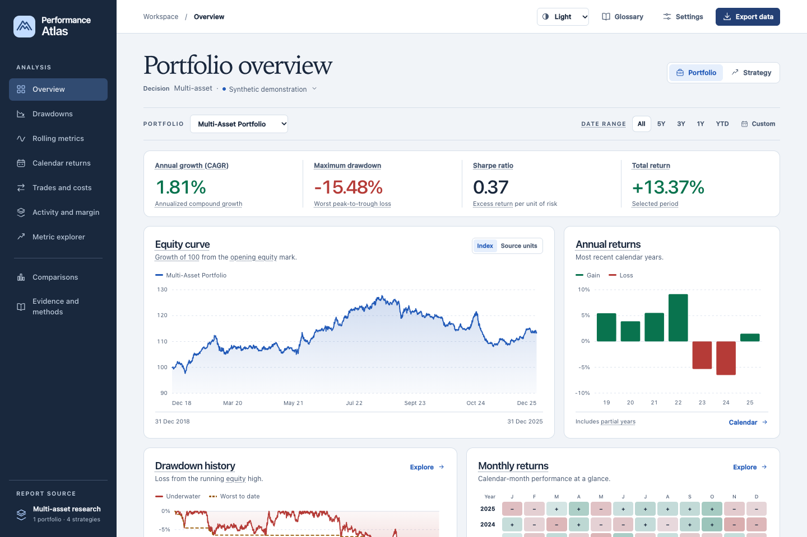

# Performance Atlas Dashboard

**Performance Atlas Dashboard** is the reporting product in this fork of `Quantreo/ai-quant-pod`. The upstream research workflows remain available in the repository. Open the example, switch between Portfolio and Strategy, and choose a series. The same controls work across instrument types, trading frequencies and strategy families.

AI coding assistant: **OpenAI Codex, GPT-6 Luna**.

[Open the standalone example](examples/performance/report.html) · [Reporting guide](docs/performance.md) · [Example input manifest](examples/performance/report.json)



## Open the example

Download the example HTML file and open it in a browser. The charts, settings and data are in that file. To build a fresh copy from the repository root, use Python 3.12 or later.

```sh
python3 -m lab.performance --demo --output results/performance/report.html
```

The demo contains four synthetic strategy histories, their funded portfolio and a synthetic benchmark. Open **Activity and margin** to inspect strategy counts and modeled overnight capital for each session. Open **Comparisons** on a strategy to inspect its return correlations with peers. Hover or tap an underlined term for its definition, or search **Glossary**. The appearance menu follows your system by default and also offers **Light** and **Dark**. Each shareable HTML file includes its underlying observations, trade records and source metadata.

## Use your own results

1. Copy the example manifest, its CSV, and the optional [overnight activity example](examples/performance/overnight.json). Give each strategy, portfolio and benchmark a unique ID. Remove the `activityFile` entry to use only equity histories.
2. Supply a performance history, currency, return sampling interval and periods per year for each series. A portfolio accepts the actual portfolio equity or its dated net P&L stream.
3. Build the report and open the HTML file in a browser.

```sh
python3 -m lab.performance --config examples/performance/report.json --output results/my-report.html
```

The portable builder uses the Python standard library. The Quantreo adapters use the upstream research environment. Both routes produce the same interface. The report also accepts optional benchmark, trade, cost, exposure and custom metric data. [Inputs, native commands and calculation methods](docs/performance.md)

The upstream project contains the research workflow, backtest engine, strategy examples, and construction and review processes. [Quantreo/ai-quant-pod](https://github.com/Quantreo/ai-quant-pod)
