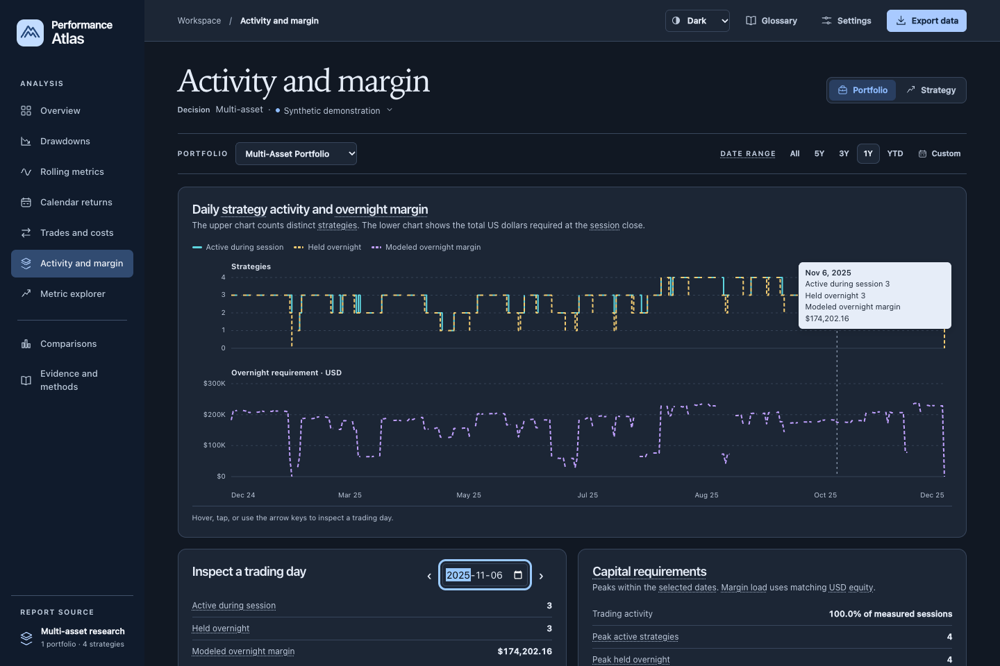

# Performance Atlas Dashboard reporting guide

One HTML file holds the data, calculations and charts. It opens from disk and works without a server. Generate a separate file for each dataset you want to share. A recipient can read all embedded records, including trade histories and source metadata. The synthetic example includes a [reproducible evidence manifest](../examples/performance/research_tests/manifest.json).

## Report build identity

Open **Build details** in the report footer. The release version `YYYY.MM.DD+<first 12 SHA>` uses the UTC committer date and revision from `nishantpatel9999/performance-atlas-dashboard`, channel `codex/performance-report`. Tags and manual version bumps are unnecessary. The report build time (`built_utc`) and the dates covered by each series have separate meanings.

Read the machine-readable stamp from `script#atlas-build[type="application/json"]`. For a channel release it contains schema `1`, skill `performance-atlas-report`, repository, channel, full 40-character `revision`, `revision_utc`, `version` and `built_utc`. Both timestamps use UTC with a trailing `Z`. Compare it with `provenance.report_build` in the report evidence. A legacy report with no identity has an unknown release.

The low-level builder also works offline. It identifies a downloaded package verified against its Git revision or a clean known checkout. Otherwise it records a local source fingerprint. A fingerprint alone cannot confirm the current channel head. To reproduce an original build clock when explicitly needed, set `SOURCE_DATE_EPOCH` to the original build time in Unix seconds.

## Choose a view

| View | Questions it answers |
| --- | --- |
| Overview | How did capital grow? Read CAGR, maximum drawdown and Sharpe together. Inspect the full equity path in source units or indexed to 100. |
| Drawdowns | How deep was each loss? When did it start, bottom, and recover? Read its depth in percent and source units, and compare net gains with the largest cash loss using recovery factor. Compare underwater drawdown, maximum drawdown to date and the worst loss inside a rolling window. |
| Rolling metrics | Did performance persist? Explore trailing return, volatility, Sharpe, Sortino, Calmar and maximum drawdown. The default is six calendar months. Compare the share of profitable 6-, 12- and 18-month windows with the number eligible at each horizon. |
| Activity and margin | How many strategies held risk during each session? How many remained open at the close? Inspect their counts beside the overnight USD requirement. Select a date to see its source or calculation. |
| Calendar returns | Which years and months contributed? Compare each year's return, maximum drawdown and Sharpe. Read the mean of complete years separately from full-period CAGR. The monthly heatmap also shows changes in account units. |
| Trades and costs | Inspect trade P&L, win rate, profit factor, payoff, expectancy, win and loss streaks, holding time, chronological trade results and recorded costs. Compare counts, gross profit and loss, expectancy, and winner or loser concentration for all, long and short trades. |
| Metric explorer | Chart an individual metric, inspect its distribution and download its dated values. Add your own measured series, such as net exposure or turnover. |
| Comparisons | Filter the strategy scorecard by name, family or asset class. Compare two indexed capital paths on a common window. Inspect correlation, beta, alpha, tracking error, information ratio, capture and rolling correlation. Open the strategy correlation matrix from either scope. Choose a focus strategy to see its coefficients and matched return counts. **Show all strategies** displays the full comparison group. A portfolio can also show construction weights and reconciled contributions. |
| Evidence and methods | Check the capital basis, cost assumptions, timestamps, sample size, gaps, calculation conventions and research-test coverage. |

The **System** appearance follows the operating system. Choose **Light** or **Dark** in the header to override it. The browser remembers the choice when it permits local storage. Hover, focus or tap a marked term for a plain-language definition. **Glossary** searches the terms in the offline HTML, including descriptions supplied with custom metrics. A report may also supply a top-level `glossary` object that maps a custom term to its definition.

Use **Settings** to change the date range, rolling window, annual risk-free rate or downside target. Use a chart's pointer or left and right arrow keys to inspect individual marks. **Export data** downloads the selected equity and drawdown series. In Metric explorer it downloads the selected metric. In Activity and margin it downloads dated counts, the dollar requirement, and its basis. Source totals retain their original dates.

**Interpreting the additional statistics.** The gain-to-pain ratio divides the sum of signed period returns by the absolute sum of negative returns. Cumulative log return is the natural logarithm of ending equity divided by opening equity. Both equity values must be positive. In the trade table, the largest winner’s share of gross profit and largest loser’s share of gross loss show whether a few trades dominate the result. The rolling success percentages use overlapping historical windows. The table gives the eligible count and exclusions for each horizon.

Both the Overview and Calendar heatmaps show a **Year return** column after December. It uses the opening and closing equity for the displayed part of each year. A dagger (†) marks a partial period. A double dagger (‡) marks a gap. The **Average** row uses the entire history of the selected strategy or portfolio, including years outside the current date filter. Each month has equal weight across years with complete observations. A measured 0% counts. Missing, partial and gapped periods are excluded. The last cell averages complete calendar years. The Calendar view also shows the change in account currency, currency per unit, or index points. Each average amount uses the same periods as its percentage. Hover or focus an average to read its sample count.

### Select a strategy on a phone

Open the strategy or portfolio field. The picker shows the current selection and the number of available choices. Swipe the list to reach either end. Tap a name to update the current report view, or tap Close to keep your selection. In a report that loads portfolios separately, the strategy count applies to the loaded portfolio.

When verifying a report, use a list longer than the phone screen. Swipe to the last item, select it and check the displayed history. Reopen the picker and check that the selected item is visible. Repeat in landscape and check that the desktop selector still works.

## Connect a project

Start with [the example manifest](../examples/performance/report.json), [its monthly CSV](../examples/performance/monthly-marks.csv), and [its optional activity file](../examples/performance/overnight.json). For every new build or rebuild, follow the [release selection and build commands](../README.md#create-a-report-with-an-ai-agent), even from `main` or an installed skill. Read the returned immutable skill and run the build, evidence and calendar checks at that revision. If resolution fails, report that latest is unverified.

A standalone `python atlas_release.py build --config CONFIG --output HTML` resolves a fresh channel head when no revision is supplied. Read the resulting full SHA from **Build details** and pin any follow-up checks to it. Use a historical SHA only for a requested reproduction.

Each series has a unique `id`, a display `name`, a `kind` of `strategy`, `portfolio` or `benchmark`, a `currency`, a sampling `frequency` and `periodsPerYear`. Set `currency` to `INDEX` for dimensionless capital. A report can include multiple portfolios, benchmarks, strategy families, asset classes and overlapping histories. A currency-denominated benchmark can represent 100 units of that currency invested at its opening mark.

| Input mode | Supply | Equity calculation |
| --- | --- | --- |
| `equity` | Dated equity or unitized net asset values, including the funded opening mark | Use the recorded values. |
| `returns` | Dated net simple returns, opening capital and opening date | Multiply each prior balance by one plus the net return. |
| `contributions` | Dated net P&L as a fraction of initial capital, opening capital and opening date | Add each contribution times the original capital. |

Set `csv` to a path relative to the manifest. CSV headers default to `date,equity` for equity and `date,net` for returns or contributions. Use `dateColumn` and `valueColumn` to select different fields. Return modes require `openingCapital` and `openingDate`. Use decimals for returns, such as `-0.012` for a 1.2% loss. Supply unitized equity or an equivalent time-weighted return history when the account has external deposits or withdrawals.

UTC dates such as `2025-01-31` describe daily marks. Use a timestamp with an explicit offset for intraday marks. Mark times must be strictly increasing. The first mark has positive capital. A capital path ends at its first nonpositive mark. A terminal loss can exceed 100% if the source records negative equity.

**Mark frequency and trade frequency are separate.** The report uses every supplied mark for equity and drawdown. It uses UTC period closes for return ratios. Set `frequency` to `daily`, `weekly`, `monthly` or `annual`, and set the matching annualization factor for that series. An intraday strategy can supply minute marks with daily return sampling. A monthly strategy can supply daily marks if the account was valued each day. Set `sessionDates` to a sorted array of ISO session dates for a specific exchange's daily calendar. Without a supplied calendar, the methods panel describes the gap rules.

**Currency conversion.** Combine funded positions in a common currency. To convert a CSV equity path, specify `sourceCurrency`, output `currency` and `fxColumn`. Each FX value is units of output currency per unit of source currency at that mark. Return streams also require `openingFxRate`. Supply trade P&L and costs in the output currency, with units recorded. Factor and market benchmark comparisons need compatible intervals and return bases.

A Python producer can write a canonical JSON bundle for the launcher. Here `times` contains integer Unix milliseconds in UTC and `equity` contains the corresponding values.

```python
import json
from pathlib import Path

bundle = {
    "version": 1,
    "title": "Research account",
    "series": [{
        "id": "book", "name": "Combined portfolio", "kind": "portfolio",
        "currency": "USD", "frequency": "monthly", "periodsPerYear": 12,
        "times": [1735603200000, 1738281600000, 1740700800000],
        "equity": [100000, 101200, 100600],
    }],
}
Path("report.json").write_text(json.dumps(bundle), encoding="utf-8")
```

With the resolved Atlas package on the Python import path, a producer can also pass the same bundle directly to the builder.

```python
from lab.performance import render_bundle
render_bundle(bundle, "results/portfolio.html")
```

Custom shell producers using the pinned package must replace the template’s `<!--REPORT_BUILD-->` slot with the trusted HTML returned by `provenance.render_stamp(provenance.make_stamp(revision, revision_utc, built_utc=built_utc))`. Use the resolved commit and its UTC committer timestamp. Omit the optional `built_utc` argument to use the build clock. Keep this stamp when assembling the final HTML.

## Add evidence and measurements

| Input | Use |
| --- | --- |
| `assetClass`, `family`, `accounting`, `status`, `costModel`, `source`, `notes` | Describe instruments, capital, simulated or live history, fees and evidence quality. |
| `benchmarkId` | Reference a benchmark history in the same manifest. Choose a benchmark appropriate to the strategy or portfolio. |
| `tradesCsv` | CSV with `time,pnl` for each closed trade. Optional `side` and `holdingHours` columns enable side and holding-time analysis. An inline `trades` array uses epoch milliseconds. |
| `tradeSummary`, `costs`, `sourceMetrics` | Full-history source figures. Include cost currency and identify the costs covered by each total. The date filter applies to dated observations. |
| `holdings` | A list of `{"id":"strategy-id","weight":0.30}` objects. State the date and meaning of the snapshot in `evidence.holdingsBasis`, such as ending net equity or target risk budget. |
| `evidence.attribution` | For explicitly funded sleeves, set `{"basis":"funded_equity","members":["trend","carry"]}`. The analyzer checks the currency, dates and portfolio reconciliation before reporting contributions. |
| `diagnostics` | Additional dated measurements for each strategy or portfolio. Each record has `name`, `unit`, optional `description`, and `times` and `values` arrays or a relative CSV. Unit `%` takes fractions. Missing values appear as gaps. |
| `evidence` | Attach run version, rules, time splits, cost assumptions, capacity estimates and completed research tests. [Evidence manifest and coverage](report-coverage.md) |

For example, this diagnostic reads two columns from a local CSV. Use the same pattern for gross or net exposure, turnover, leverage, margin, costs, fill rate or option sensitivities. Keep the actual unit on each measurement.

```json
{"name":"Gross exposure","unit":"%","csv":"exposure.csv","dateColumn":"date","valueColumn":"gross","description":"Absolute market value divided by net asset value."}
```

Some measures need additional evidence before they have a clear interpretation. Liquidity and capacity need order size, market volume and a cost or impact model. Trade excursions need prices while each trade was open. Portfolio contribution needs reconciled component histories. Walk-forward, cost stress, parameter sensitivity and resampling need actual test runs. Use the coverage view to see which records the source supplies.

## Historical activity and overnight margin



Attach an `activityFile` to each portfolio. It accepts a CSV of daily totals or a JSON file with positions, rules, exchange rates and broker totals. Use the trading date assigned by the broker. Instruments that trade across midnight can have a different trading date from their UTC close date. The portfolio may have daily, intraday or monthly equity marks.

| Daily CSV field | Meaning |
| --- | --- |
| `date` | Broker session date in YYYY-MM-DD format. Include one row per expected trading day, or give the JSON file a `sessionDates` list. |
| `active` | Distinct strategies that held a position at any time during the day, including a position closed during that session. |
| `overnight` | Distinct strategies with a nonzero position at the close. Two strategies on opposite sides of one contract can both count. |
| `marginUsd` | Total overnight margin or required equity for the account scope, in US dollars. A blank means the value is unknown. Zero records a confirmed zero requirement. |
| `marginBasis` | Use `broker_requirement` for a reported overnight margin amount, `required_equity` for a broker equity requirement, or `schedule_estimate` for a documented historical model. Use `unknown` for an unrecorded amount. |

Broker buying power, interest paid on a margin loan, account equity, and the overnight capital requirement are different fields. Use the applicable dated overnight requirement. For a book with several accounts, declare `accountIds` and supply their dated `accountTotals` on the same basis. Complex options, spreads, portfolio margin, house minimums and cross-product credits need an account-level amount or a separately validated calculation. TradeStation describes separate rules for stock accounts, options positions and overnight futures contracts. [Equities margin](https://www.tradestation.com/accounts/margin-trading/) · [Options margin](https://www.tradestation.com/pricing/options-margin-requirements/) · [Futures margin](https://www.tradestation.com/pricing/futures-margin-requirements/)

**To calculate an estimate**, supply signed closing quantities per account, strategy and exact instrument. Set `heldDuring` for positions that opened and closed in one session. Declare the coverage of the intraday and closing ledgers. For a simple additive model use `marginModel: "simple_net"`. A dated rule must cover the session, instrument or product, and closing side. Per-contract rules multiply the absolute net contract count by the applicable amount. Notional rules also use the closing price, contract multiplier and rate. A non-USD rule needs the same session’s USD exchange rate. Enter the actual rule inputs for each instrument, including currency futures, spot FX or commodity contracts. Symbols with distinct expirations or option terms need distinct identifiers.

The five-session example shows a modeled USD 318 requirement on December 22, a missing FX rate on December 26, an account-level options amount on December 27, required equity on December 28, and an intraday exit with zero overnight margin on December 29. All figures are synthetic. Click a date to see the inputs behind a calculation. The seven-year standalone demo uses actual simulated positions, with explicitly illustrative long and short rates. [Worked example](../examples/performance/overnight.json)

## Native Quantreo runs

Use the strategy HTML or book construction HTML entry point from the pinned release in the project's Quantreo environment. Bind its data root to the actual project containing the vault, saved runs and market data. Confirm the resolved paths and output destination before running. Changing the shell directory alone can leave a native adapter reading data relative to its module. If the adapter cannot bind the project root, export the project's saved marks to the portable manifest and use the pinned launcher. Keep sealed tests closed. With the engine and project paths confirmed, use the existing native commands.

```sh
python3 -m lab.strategy_report "My strategy" html --output results/strategy.html
python3 -m lab.book_report construct "Research book" html \
  --strategy "Strategy A" --strategy "Strategy B" --currency USD \
  --output results/book.html
```

Add `--activity path/to/overnight.json` or `--activity path/to/sessions.csv` to the book command to supply historical overnight capital and session activity. When eligible saved strategy runs include complete held-position records, the book can count active strategies on its UTC sessions. Overnight positions and broker capital requirements need separate recorded evidence.

Native HTML exports infer a Monday–Friday calendar when marks span at least 14 days, cover all five weekdays and contain no weekends. Use `--calendar weekday` to select 252 periods per year, or `--calendar daily` to select seven-day sampling at 365. For exchange holidays and other schedules, use `--session-dates sessions.json` with an object containing `sessionDates` and `periodsPerYear`. The report records the source of its calendar assumption and counts missing expected sessions. Native book sizing retains the desk's 365-period convention.

Native P&L is recorded as a contribution to initial capital. The HTML report also computes account-level returns from the resulting equity marks. The native desk's annual mean contribution and an equity CAGR answer different questions. Its target risk weights describe construction, while cash portfolio weights require actual funded positions. Use the generic CSV route to display a separately generated portfolio or historical allocation decision.

## Calculation references

The Sharpe calculation uses excess returns and the sample standard deviation. The Sortino calculation uses the full sample's root mean square shortfall below the chosen target. The report shows the annualization factor, calendar, and active rates with the source data. [William F. Sharpe, The Sharpe Ratio](https://web.stanford.edu/~wfsharpe/art/sr/sr.htm) · [CFA Institute, The Sortino Ratio](https://rpc.cfainstitute.org/-/media/documents/code/gips/the-sortino-ratio.pdf)
